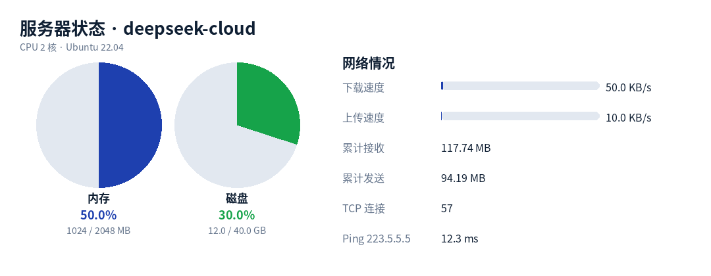

# astrbot_plugin_sysstatus

AstrBot 插件：让 QQ 机器人发送服务器状态图，包含内存/磁盘扇形图和网络情况可视化。

## 功能

- 内存、磁盘占用扇形图
- 网络下载/上传速度、累计收发、TCP 连接数、Ping 延迟
- 指令：`/服务器状态`（别名 `/状态`、`/系统状态`、`/sysstatus`）
- LLM 工具：`send_server_status_image`，用户自然语言询问服务器状态时自动调用
- 输出为 PNG 图片，直接发送到当前会话

## 效果



> 预览图使用示例数据生成；实际数值来自你的服务器。

## 工作原理

AstrBot 运行在容器里，默认读不到宿主机真实的 `/proc/meminfo` 和磁盘信息。因此本插件通过一个**宿主机上的 hoststats 接口**获取数据：

```text
AstrBot 容器
  └── GET http://host.docker.internal:<port>/api/hoststats
        Header: X-Hoststats-Token: <token>
        ↓
宿主机 hoststats 服务
  ├── /proc/meminfo
  ├── statvfs("/")
  ├── /proc/net/dev
  └── ping
```

插件会读取一个只读挂载的 token 文件，并在请求头里带上它。接口需要返回：

```json
{
  "server": {
    "hostname": "my-server",
    "os": "Ubuntu 22.04",
    "cpu": {"count": 2, "model": "Intel Xeon"},
    "memory": {"total_mb": 2048, "used_mb": 1024},
    "disk": {"total_gb": 40, "used_gb": 12, "use_percent": 30}
  },
  "network": {
    "rx_speed_bps": 51200,
    "tx_speed_bps": 10240,
    "rx_bytes": 123456789,
    "tx_bytes": 98765432,
    "tcp_connections": 57,
    "ping_ms": 12.3
  }
}
```

`server` 至少需要 `hostname`、`memory.total_mb`、`memory.used_mb`、`disk.total_gb`、`disk.used_gb`、`disk.use_percent`；`network` 的字段缺失时会显示 `—`。

## 安装

1. 把本仓库目录放到 AstrBot 的 `data/plugins/astrbot_plugin_sysstatus/`
2. 准备 hoststats 服务（见下方“hoststats 服务”）
3. 把 token 文件只读挂载到容器内，例如：

```yaml
services:
  astrbot:
    extra_hosts:
      - "host.docker.internal:host-gateway"
    volumes:
      - ./hoststats_token:/app/hoststats_token:ro
```

4. 重启 AstrBot，或重载插件

## 配置

| 配置项 | 默认值 | 说明 |
| --- | --- | --- |
| `panel_url` | `http://host.docker.internal:80` | 宿主机 hoststats 服务地址 |
| `token_file` | `/app/hoststats_token` | 容器内 token 文件路径 |

在 AstrBot 插件配置页修改后保存即可。

## 使用

```text
/服务器状态
```

或直接问机器人：

```text
看下服务器内存和网络
```

## hoststats 服务

本仓库不包含完整的宿主机监控服务，只定义接口契约。你可以用任何语言实现，最小实现需要：

- 监听一个宿主机端口
- 校验 `X-Hoststats-Token`
- 返回上面的 JSON

如果你使用本项目的配套管理面板，可直接复用它的 `/api/hoststats` 接口。

安全建议：

- token 使用随机长字符串，文件权限 `600`
- hoststats 端口只绑定 `127.0.0.1` 或 Docker 网关，不要直接暴露公网
- 不要把 token 提交到 Git

## 依赖

- AstrBot >= 4.0.0
- Pillow（AstrBot 镜像通常已内置）
- 中文字体：`/usr/share/fonts/opentype/noto/NotoSansCJK-Regular.ttc`（缺失时回退默认字体）

## 许可

MIT License，见 [LICENSE](LICENSE)。
